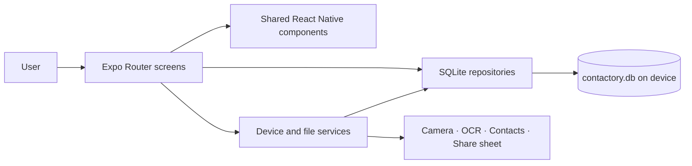
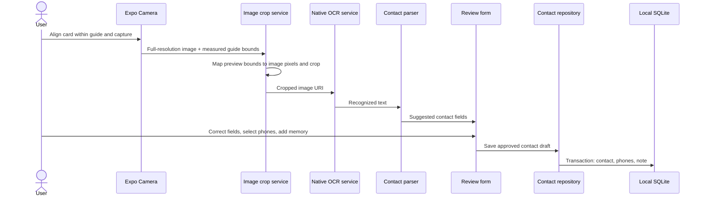

# Contactory project architecture

## Product and runtime model

Contactory is an offline-first Android and iOS contact memory app. It has no application server, API, login, cloud database, or runtime backend. Business logic and persistent contact data live on the device. Expo Application Services (EAS) is used to build and distribute native app binaries; it is not part of the app's runtime data path.



## Frontend

The UI uses React Native and TypeScript. Expo Router maps files under `app/` to routes. Screens compose reusable controls from `src/components/`, use feature components under `src/features/`, and call services or repositories for device and data operations.

Main routes:

| Route | Responsibility |
| --- | --- |
| `app/index.tsx` | Redirects based on locally stored onboarding state. |
| `app/onboarding.tsx` | First-run onboarding. |
| `app/` home screen | Home experience and recent contacts. |
| `app/scan/index.tsx` | Camera permission, live guide, camera capture, and gallery selection. Camera captures are cropped to the visible guide before preview. |
| `app/scan/preview.tsx` | Photo preview and OCR handoff. |
| `app/scan/review.tsx` | Route wrapper for the shared contact review form. |
| `app/contacts/` | Contact list, add, edit, and detail views. |
| `app/tags.tsx`, `app/groups/[id].tsx` | Create and assign optional local tags; open contact groups. |
| `app/duplicates.tsx` | Review email/phone matches and merge into the selected surviving contact. |
| `app/search.tsx` | Local search across contact and memory fields. |
| `app/settings.tsx` | Appearance selection, data export/deletion, and device settings links. |
| `app/privacy.tsx` | In-app privacy policy draft. |

Shared UI is in `src/components/` (`Screen`, `ScreenHeader`, `Field`, `ActionButton`, and `Mark`). Contact entry and editing share `src/features/contacts/ReviewContactScreen.tsx`; the home experience is in `src/features/home/HomeScreen.tsx`.

### Themes and design

`src/theme/tokens.ts` defines shared spacing, radius, typography, and light/dark color palettes. `src/theme/ThemeProvider.tsx` exposes the selected palette to screens and components. The selected appearance is stored as `theme_preference` in SQLite `app_metadata`, so it survives app restarts. Screens build their styles from the active palette. Elevated cards, restrained shadows, scan-card highlights, and press feedback provide depth without a separate 3D rendering engine.

## Contact capture and extraction flow



The guide is measured in screen coordinates. `src/services/images/cropToGuide.ts` maps those bounds to the captured image using the camera preview's center-fill scaling, then crops the file with `expo-image-manipulator`. This is a fixed guide crop: the user still aligns the card inside the guide; the app does not perform automatic card-edge detection or perspective correction.

The cropped image is passed to `src/services/ocr/recognizeText.ts`, which wraps `expo-ocr-kit` (on-device Apple Vision on iOS and ML Kit on Android). `src/services/ocr/contactParser.ts` deterministically extracts likely fields. The user reviews the suggestions before anything is saved. Raw OCR text and camera files are not retained after the review flow. Gallery images remain in the user's photo library; Contactory does not delete them.

OCR requires a Contactory development or release build containing the native module. Expo Go does not include `expo-ocr-kit`; camera cropping uses Expo's image manipulation API and can run in an Expo Go-compatible client, but this project's complete scan flow is intended for a development build.

## Local data layer and relationships

SQLite (`expo-sqlite`) is the source of truth. `src/database/database.ts` opens `contactory.db`, enables WAL and foreign keys, creates the schema, and provides app metadata helpers. `src/database/repositories/contactsRepository.ts` owns contact CRUD, search, duplicate detection, and delete operations. UI screens do not issue contact SQL directly.

```mermaid
erDiagram
  CONTACTS ||--o{ CONTACT_PHONES : has
  CONTACTS ||--o{ CONTACT_NOTES : remembers
  CONTACTS }o--o{ TAGS : organized_by

  CONTACTS {
    text id PK
    text full_name
    text first_name
    text last_name
    text company
    text job_title
    text email
    text website
    text address
    text native_contact_id
    text created_at
    text updated_at
  }
  CONTACT_PHONES {
    text id PK
    text contact_id FK
    text phone_number
    text label
    integer is_primary
    text created_at
  }
  CONTACT_NOTES {
    text id PK
    text contact_id FK
    text content
    text meeting_date
    text location
    text created_at
    text updated_at
  }
  TAGS { text id PK; text name; text kind }
  CONTACT_TAGS { text contact_id FK; text tag_id FK; text created_at }
  APP_METADATA {
    text key PK
    text value
  }
```

`contact_phones.contact_id`, `contact_notes.contact_id`, and `contact_tags.contact_id` reference `contacts.id` with `ON DELETE CASCADE`. `contact_tags.tag_id` references `tags.id`. Suggested tags are seeded locally but unassigned. `app_metadata` has independent key/value rows, currently including onboarding completion and appearance preference. Indexes cover contact names, companies, and child-to-contact lookups.

The review workflow saves an optional memory note per contact. Card images and OCR output exist only as transient scan inputs; there is no scan-history table or file retention. Duplicate review uses email and phone matches; a merge transaction moves all notes, unique numbers, and tag memberships into the selected surviving contact, fills its missing fields, and deletes the duplicate. The `native_contact_id` column is an optional identifier returned by the device Contacts system; it is not a foreign key into SQLite. Deleting a Contactory contact does not delete the native phone contact.

Contact, selected phone numbers, and the current note are written inside a SQLite transaction. Search uses local parameterized `LIKE` queries across identity, phone, and note fields. Export reads the repository's contact records and writes a temporary CSV for the system share sheet.

## Device services and libraries

| Library / technology | Role | Main location |
| --- | --- | --- |
| Expo SDK 57 | Native app runtime, modules, and project configuration. | `app.json`, `package.json` |
| React 19, React Native 0.86, TypeScript | UI and typed application logic. | `app/`, `src/` |
| Expo Router | File-based navigation and route parameters. | `app/` |
| `expo-sqlite` | On-device schema, metadata, and contact data. | `src/database/` |
| `expo-camera` | Live camera and full-resolution card capture. | `app/scan/index.tsx` |
| `expo-image-picker` | Select an existing card image. | `app/scan/index.tsx` |
| `expo-image-manipulator` | Crop the camera photo to the measured guide region. | `src/services/images/cropToGuide.ts` |
| `expo-ocr-kit` | Native on-device text recognition; requires a custom native build. | `src/services/ocr/recognizeText.ts` |
| `expo-contacts` | Optional create/update in phone Contacts; copies the Contactory memory into the phone contact’s Notes field. | `src/services/contacts/nativeContacts.ts` |
| `expo-file-system` | Temporary image cleanup and CSV file creation. | `app/scan/`, `src/services/export/` |
| `expo-sharing` | Open the operating system share sheet for CSV export. | `src/services/export/exportContacts.ts` |
| `expo-haptics` | Capture and destructive-action feedback. | Scan and settings screens |
| `expo-linking` / React Native `Linking` | Open system settings and contact actions such as phone, email, and web. | Camera permission and contact detail screens |
| `expo-status-bar`, `react-native-safe-area-context` | Status bar and safe-area layout. | `app/_layout.tsx`, screens, shared `Screen` |
| Jest, `jest-expo`, React Native Testing Library | Parser, repository contract, home UI, and crop-geometry checks. | `src/**/*.test.ts(x)` |
| EAS Build / `expo-dev-client` | Cloud native builds and installed development client. | `eas.json` |

## Build and development

`eas.json` defines `development`, `preview`, and `production` profiles. The development profile is an internal installable Android build with `expo-dev-client`; the currently configured example app identifier should be replaced before release. Adding `expo-image-manipulator` is a native dependency, so an existing development APK must be rebuilt once to include it. After installing that build, ordinary TypeScript/UI changes can be served with `npm run start:dev` and Metro fast refresh; changes to native dependencies, native permissions, or config plugins require another native build.

## Repository map

```text
app/                         Expo Router route screens
src/components/              Reusable UI controls
src/database/                SQLite initialization and repositories
src/features/contacts/       Shared contact review/edit feature
src/features/home/           Home feature
src/services/contacts/       Native Contacts adapter
src/services/export/         CSV and share-sheet service
src/services/images/         Camera guide crop geometry and image crop
src/services/ocr/            OCR bridge and deterministic parser
src/theme/                   Tokens and persisted theme context
src/types/                   Contact and OCR models
docs/                        Implementation and release checklists
```
