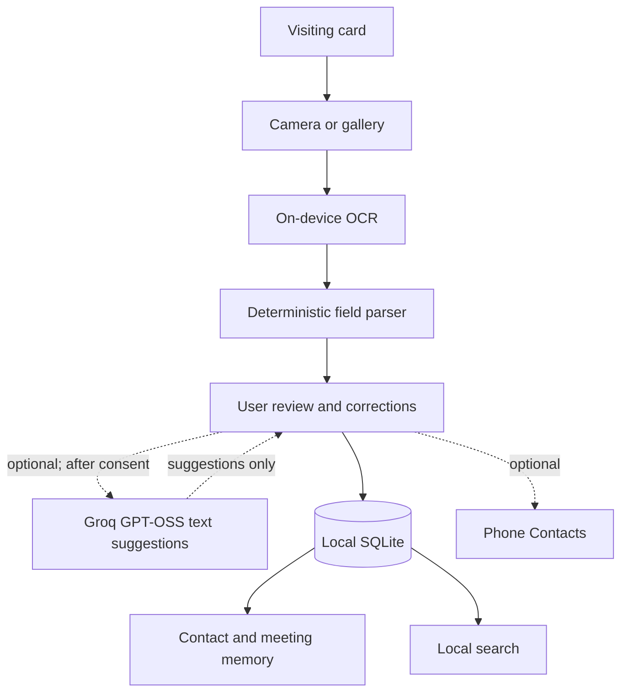
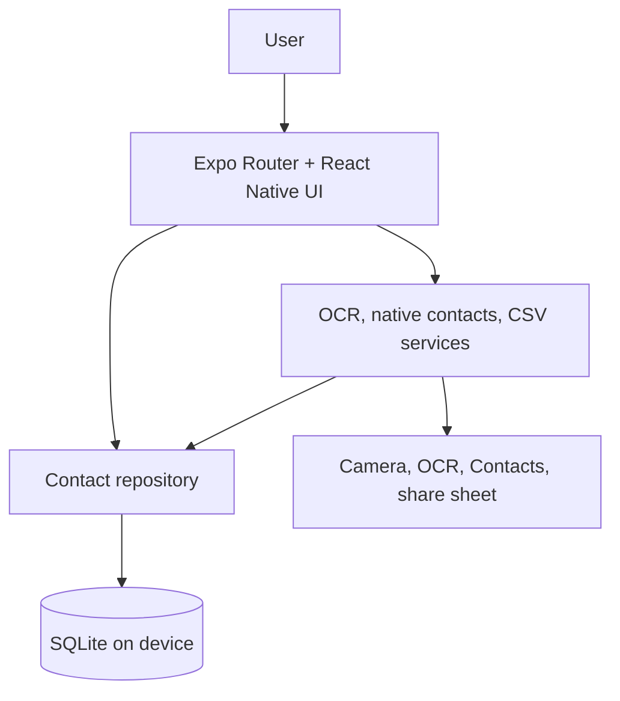

# Vemori

> Every connection, remembered.

Vemori is a local-first networking memory app. It keeps a person’s contact details and the
context of meeting them together. No account is required.

## Product flow



## Architecture



## Included features

- Three short onboarding screens and a local-first home screen.
- Camera capture and gallery image selection with contextual camera permission.
- On-device OCR using Google ML Kit on Android and Apple Vision on iOS.
- Deterministic parsing for names, companies, titles, phone numbers, email, website, and
  address.
- Optional, user-triggered Groq GPT-OSS suggestions for name, company, and title; the local
  parser remains the fallback.
- Editable review, independent phone selection, personal note, meeting date, and location.
- Local SQLite storage, contact editing/deletion, detail view, call/message/email/website
  actions.
- Search by contact fields and memory text.
- Optional save to the native phone Contacts app.
- CSV export via the operating system share sheet; local-only delete confirmation.
- Optional suggested and custom tags, with tappable groups from the home screen.
- Duplicate review using matching email/phone values; merge keeps all notes, unique numbers,
  tags, and fills missing details into the selected record.
- Google Play deployment walkthrough in `docs/PLAY_STORE_DEPLOYMENT.md`.
- AI and project architecture explainer in `docs/AI_AND_ARCHITECTURE.md`.

Card images and raw OCR text are temporary and are not retained by Vemori after review.
There is no card-image history. Contacts, notes, and tags are stored in local SQLite on the
device. AI suggestions are optional: after per-scan confirmation, Vemori sends recognized
text (not the image) through the configured Worker to Groq GPT-OSS. Vemori does not persist
this request; Groq's current data controls and retention terms apply. If users choose “Also
save to phone Contacts,” selected details and the memory note are copied to the device
Contacts app and may sync through that account. The developer reports successful AI-assisted
scans of the shared test cards; this does not guarantee results on every card. See [the AI
and architecture explainer](docs/AI_AND_ARCHITECTURE.md) and [the Google Play deployment
guide](docs/PLAY_STORE_DEPLOYMENT.md).

## Tech stack and structure

- Expo SDK 57, React Native 0.86, TypeScript, Expo Router.
- SQLite via `expo-sqlite`, behind a repository for contact operations.
- Camera and system integrations through Expo SDK modules.
- `expo-ocr-kit` provides a small cross-platform wrapper over on-device ML Kit and Vision.

```text
app/                         Expo Router screens
src/components/              Shared UI pieces
src/database/                 SQLite setup and repositories
src/features/contacts/        Review and edit UI
src/features/home/            Home experience
src/services/ocr/             OCR service and deterministic parser
src/services/contacts/        Native Contacts adapter
src/services/export/          CSV export and share
src/theme/                    Design tokens
src/types/                    Contact and OCR models
docs/                         Play deployment and AI/architecture guides
server/groq-proxy/            Cloudflare Worker proxy; Groq key stays server-side
```

## Install dependencies

Use Node.js 22.13 or later. From the repository directory:

```sh
npm install
npx expo install --fix
```

`expo install --fix` aligns Expo SDK package versions. Dependencies are installed and
aligned with Expo SDK 57. TypeScript and relevant OCR/AI tests pass in this workspace. The
developer has also reported successful on-device scans of the shared sample cards; broader
device and Play release validation remains to be completed.

## Run in Expo Go

1. Install the Expo Go app that supports SDK 57 on your phone.
2. Connect your phone and computer to the same network.
3. Run:

   ```sh
   npm start
   ```

4. Scan the QR code with the camera (iOS) or Expo Go (Android).

Expo Go can run onboarding, SQLite, camera/gallery capture, manual entry, contact editing,
notes, local search, and CSV sharing. **OCR uses a custom native module and is not included
in Expo Go.** If you tap Read this card in Expo Go, Vemori explains the limitation and lets
you enter details manually. Native Contacts write behavior is also platform-dependent in
Expo Go; use a development build to validate it.

## Run with OCR and native integrations

OCR requires a development build. On a platform with its native toolchain installed:

```sh
npx expo prebuild
npx expo run:android
# or
npx expo run:ios
```

Or build through EAS:

```sh
npx eas-cli build --profile development --platform android
npx eas-cli build --profile development --platform ios
```

After installing the development build, start Metro with `npm run start:dev` and open Vemori
from the dev client. `npm start` intentionally targets Expo Go.

## Share a private test build

To share an installable Android APK with a few testers, use the EAS `preview` profile. It
runs on its own and does not need a development server:

```sh
npx eas-cli build --profile preview --platform android
```

## Local data and privacy

SQLite is the local source of truth. Contacts, phones, notes, native contact IDs, and
minimal app metadata are stored on device. Foreign keys cascade when local contacts are
deleted. No login, analytics, advertising, or automatic contact upload is configured.
Optional AI suggestions require explicit confirmation for each scan and send only OCR text
to the configured Groq proxy. The current Worker is a public endpoint with basic per-IP rate
limiting; production rollout needs additional abuse controls and matching privacy/Data
safety disclosures. SQLite encryption is not enabled or claimed.

Before release, publish a privacy policy that matches the final build and complete Play
Console's disclosures. Follow [the Google Play deployment
guide](docs/PLAY_STORE_DEPLOYMENT.md) for the publishing steps.

## Validation and release

```sh
npm run typecheck
npx expo-doctor
npm run start
```

Use the device validation steps in [the Google Play deployment
guide](docs/PLAY_STORE_DEPLOYMENT.md) for camera/OCR/permission/restart checks. The
developer reports successful scans of the shared sample cards on-device; the remaining
release checks, publisher credentials, and store approval are not claimed. The Android
package and iOS bundle identifiers in `app.json` are currently `com.tiger.vemori`; confirm
they are controlled by the publisher before the first store upload.
