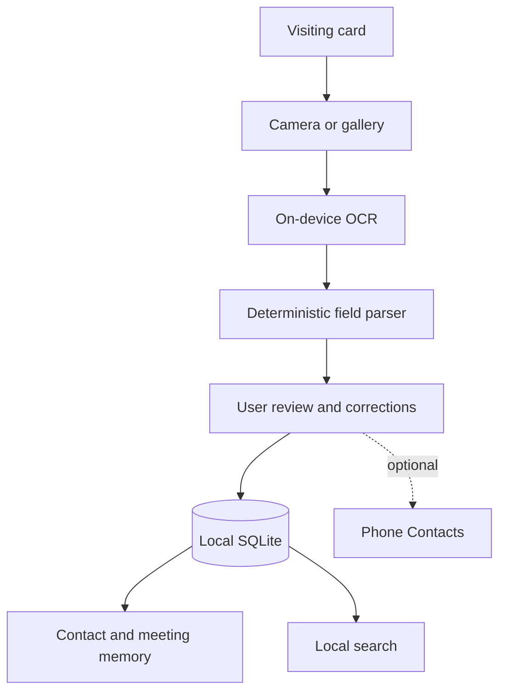
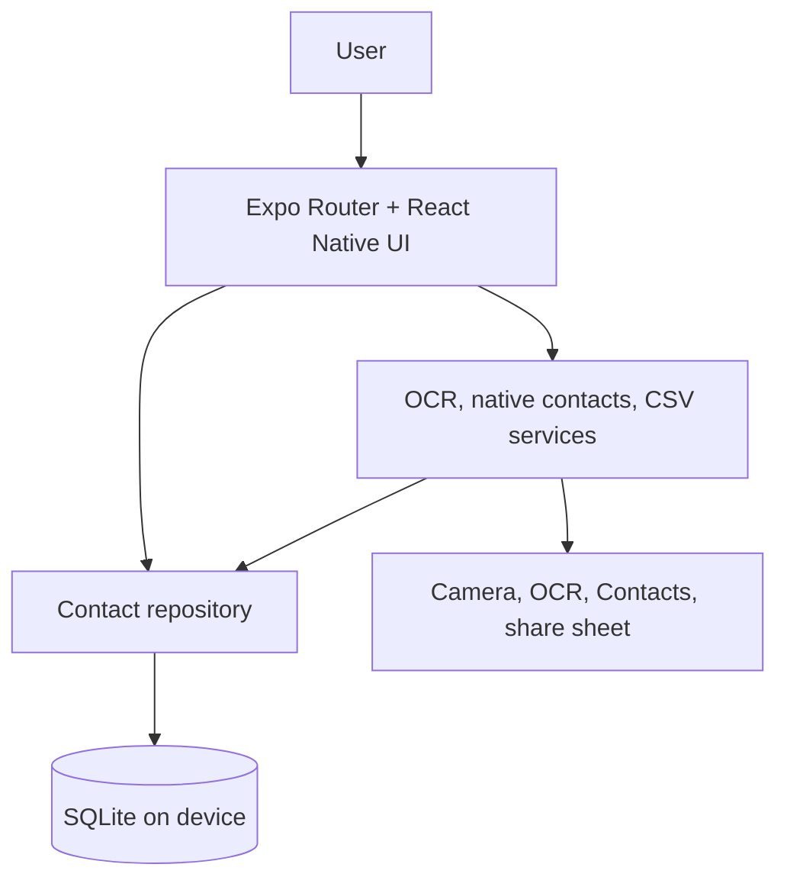

# Vemori

> Every connection, remembered.

Vemori is a local-first networking memory app. It keeps a person’s contact details and the context of meeting them together. No account is required.

## Product flow



## Architecture



## Included features

- Three short onboarding screens and a local-first home screen.
- Camera capture and gallery image selection with contextual camera permission.
- On-device OCR using Google ML Kit on Android and Apple Vision on iOS.
- Deterministic parsing for names, companies, titles, phone numbers, email, website, and address.
- Editable review, independent phone selection, personal note, meeting date, and location.
- Local SQLite storage, contact editing/deletion, detail view, call/message/email/website actions.
- Search by contact fields and memory text.
- Optional save to the native phone Contacts app.
- CSV export via the operating system share sheet; local-only delete confirmation.
- Optional suggested and custom tags, with tappable groups from the home screen.
- Duplicate review using matching email/phone values; merge keeps all notes, unique numbers, tags, and fills missing details into the selected record.
- Draft privacy policy, store checklist, and device test checklist.

Card images and raw OCR text are temporary and are not retained after review. There is no card-image history. Contacts, notes, and tags are stored in local SQLite on the device; there is no app server or cloud storage. If users choose “Also save to phone Contacts,” the selected details and memory note are copied to the device Contacts app and may sync through that account.

## Tech stack and structure

- Expo SDK 57, React Native 0.86, TypeScript, Expo Router.
- SQLite via `expo-sqlite`, behind a repository for contact operations.
- Camera and system integrations through Expo SDK modules.
- `expo-ocr-kit` provides a small cross-platform wrapper over on-device ML Kit and Vision.

```text
app/                         Expo Router screens
src/components/              Shared UI pieces
src/database/                 SQLite setup and repositories
src/features/contacts/        Review and edit UI
src/features/home/            Home experience
src/services/ocr/             OCR service and deterministic parser
src/services/contacts/        Native Contacts adapter
src/services/export/          CSV export and share
src/theme/                    Design tokens
src/types/                    Contact and OCR models
docs/                         Implementation, device, and store guidance
```

## Install dependencies

Use Node.js 22.13 or later. From the repository directory:

```sh
npm install
npx expo install --fix
```

`expo install --fix` aligns Expo SDK package versions. Dependencies are installed and aligned with Expo SDK 57. TypeScript and unit checks pass in this workspace. Native builds and physical-device behavior still need device validation.

## Run in Expo Go

1. Install the Expo Go app that supports SDK 57 on your phone.
2. Connect your phone and computer to the same network.
3. Run:

   ```sh
   npm start
   ```

4. Scan the QR code with the camera (iOS) or Expo Go (Android).

Expo Go can run onboarding, SQLite, camera/gallery capture, manual entry, contact editing, notes, local search, and CSV sharing. **OCR uses a custom native module and is not included in Expo Go.** If you tap Read this card in Expo Go, Vemori explains the limitation and lets you enter details manually. Native Contacts write behavior is also platform-dependent in Expo Go; use a development build to validate it.

## Run with OCR and native integrations

OCR requires a development build. On a platform with its native toolchain installed:

```sh
npx expo prebuild
npx expo run:android
# or
npx expo run:ios
```

Or build through EAS:

```sh
npx eas-cli build --profile development --platform android
npx eas-cli build --profile development --platform ios
```

After installing the development build, start Metro with `npm run start:dev` and open Vemori from the dev client. `npm start` intentionally targets Expo Go.

## Local data and privacy

SQLite is the local source of truth. Contacts, phones, notes, native contact IDs, and minimal app metadata are stored on device. Foreign keys cascade when local contacts are deleted. No cloud service, login, analytics, advertising, or automatic upload is configured. SQLite encryption is not enabled or claimed.

The privacy policy in `docs/PRIVACY_POLICY_DRAFT.md` should be reviewed against the final build and completed with publisher and jurisdiction details before release. For first-time store publishing steps, see [the deployment and publishing guide](docs/DEPLOYMENT_AND_PUBLISHING.md).

## Validation and release

```sh
npm run typecheck
npx expo-doctor
npm run start
```

Use [the real-device checklist](docs/REAL_DEVICE_TESTING.md) for camera/OCR/permission/restart checks and [the store checklist](docs/STORE_RELEASE_CHECKLIST.md) for publishing. Android package and iOS bundle identifiers in `app.json` are placeholders (`com.example.vemori`) and must be replaced before store builds. Store approval, credentials, and physical-device validation are not claimed.
