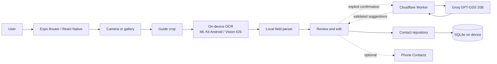

# Vemori AI layer and project architecture

This guide explains how a business card moves through Vemori, where GPT-OSS fits, which
parts run on the phone, and what happens if the AI service is unavailable.

## Contents

- [The whole app at a glance](#the-whole-app-at-a-glance)
- [Card scan, step by step](#card-scan-step-by-step)
- [What AI can and cannot do](#what-ai-can-and-cannot-do)
- [The Worker and Groq request](#the-worker-and-groq-request)
- [Data and privacy](#data-and-privacy)
- [Key source files](#key-source-files)

## The whole app at a glance



The local path works without AI: capture or choose an image, recognize text on-device, run
the deterministic parser, review the fields, and save to SQLite. The optional network path
is only entered when the user taps **Ask AI to review these fields** and confirms the
disclosure.

## Card scan, step by step

1. **Capture or choose a card.** The scan screen uses the camera or the photo picker. Camera
   images are cropped to the scan guide; Vemori does not currently detect card edges or correct
   perspective automatically.
2. **Recognize text on the device.** `src/services/ocr/recognizeText.ts` calls `expo-ocr-kit`.
   Android uses Google ML Kit; iOS uses Apple Vision. The original card image is not sent to
   the AI service.
3. **Run the local parser.** `src/services/ocr/contactParser.ts` extracts likely names,
   companies, titles, phone numbers, email addresses, websites, and addresses using patterns
   and heuristics. It can normalize credential suffixes and offers multiple name choices when
   it finds more than one plausible person.
4. **Review the local suggestions.** The review form is the point where the user can edit every
   field. No contact is saved automatically.
5. **Optionally ask GPT-OSS to map the recognized text.** The user confirms that OCR text will
   be sent to Groq. The image stays on the device. The AI suggests only name, company, job
   title, and possible name alternatives; the local parser continues to supply fields such as
   phones and email.
6. **Check and apply the answer.** The Worker requires a structured response and checks that
   each non-empty value is supported by quoted OCR evidence. The app validates that evidence
   again. Suggestions marked `low` are not applied; medium/high suggestions remain editable and
   must be reviewed before saving. Model confidence is a rough indicator, not a calibrated
   probability.
7. **Save locally.** The contact repository stores the approved contact, selected phone
   numbers, notes, and tags in SQLite. A separate user choice can copy contact data to the
   phone Contacts app.

## What AI can and cannot do

GPT-OSS receives the OCR text, not the image. It helps distinguish person names,
organizations, and job titles when the card layout or typography confuses local heuristics.
It can also return several name candidates for a card with more than one person.

It does not improve image quality or recognize text missing from the OCR result. If the name
was omitted or misread by on-device OCR, this text-only model may not be able to recover it.
A card with multiple people still saves one contact at a time; choose a name and keep the
matching number selected, then add the other person separately.

AI output is not guaranteed to be correct. The user review step is still required, and a
successful scan of the cards tested so far does not guarantee every future card.

## The Worker and Groq request

`server/groq-proxy/src/index.ts` is a Cloudflare Worker that acts as a small server-side
proxy:

- The phone sends a JSON request containing OCR text to the Worker.
- The Worker rejects empty or oversized text, applies a 12 requests per 60 seconds per-IP rate
  limit, and calls Groq's chat completions endpoint.
- The configured model is `openai/gpt-oss-20b`; the response uses Groq structured outputs with
  a strict JSON schema.
- The schema contains `full_name`, `company`, `job_title`, and `name_candidates`. Suggested
  fields include a source-evidence string and a rough confidence label.
- The Worker drops values that are not supported by their cited OCR evidence and returns a
  sanitized JSON response. It does not write requests to a database.
- The mobile client also checks the response/evidence. If networking or the Worker fails,
  local parser results remain available.

The Worker route currently deployed for testing is:

```text
https://vemori-card-suggestions.vemori-card-suggestions.workers.dev
```

The Groq API key is stored as the Cloudflare secret `GROQ_API_KEY`. It must never be added
to the app, a `EXPO_PUBLIC_` variable, `.env`, source code, or Git.
`EXPO_PUBLIC_GROQ_SUGGESTION_URL` is only the public Worker URL; local Metro reads it from
`.env`, while EAS builds read it from their matching EAS environment.

The deployed Worker is publicly addressable and currently relies on a basic per-IP rate
limit. Anyone who learns the URL may call it. Keep a Groq spending limit enabled and add
stronger abuse controls before relying on this endpoint for a public production app. A
secret embedded in the mobile client would not provide secure caller authentication.

## Data and privacy

- Contacts, notes, tags, and preferences are stored locally in SQLite. There is no login or
  cloud contact database.
- Camera/gallery OCR runs on-device. The image and raw OCR text are temporary scan inputs in
  the app.
- If the user confirms AI suggestions, the recognized text (which can include personal contact
  information) is sent to the Cloudflare Worker and Groq. The image is not sent.
- The app does not persist the AI request. Groq's data controls and applicable retention terms
  still apply; review them before a public release.
- User-triggered export and saving to phone Contacts are separate flows and follow the
  operating system's sharing/Contacts behavior.
- Before enabling AI in a Play release, make the privacy policy, Google Play Data safety
  answers, and user disclosure match the actual data flow.

## Key source files

- **Scan screens** — `app/scan/` captures or selects the image, runs OCR, and sends a
  draft to review.
- **Image crop** — `src/services/images/cropToGuide.ts` maps the viewfinder guide to the
  photo and crops it.
- **Native OCR** — `src/services/ocr/recognizeText.ts` invokes on-device OCR and normalizes
  failures.
- **Local parser** — `src/services/ocr/contactParser.ts` extracts fields with deterministic
  rules and heuristics.
- **AI client** — `src/services/ocr/aiFieldSuggestions.ts` calls the Worker, checks the
  response schema and evidence, and handles timeout/network errors.
- **Review UI** — `src/features/contacts/ReviewContactScreen.tsx` asks for consent, displays
  suggestions, and lets the user edit fields.
- **Groq proxy** — `server/groq-proxy/src/index.ts` validates requests, calls GPT-OSS, and
  returns supported suggestions.
- **Worker config** — `server/groq-proxy/wrangler.toml` defines the Worker name, model, and
  rate-limit binding.
- **Local data** — `src/database/` contains the SQLite schema, repositories, and persistence.

The broader routing, theme, native-module, and SQLite architecture is also documented in
[`PROJECT_ARCHITECTURE.md`](../PROJECT_ARCHITECTURE.md). For Play enrollment, signing,
release tracks, privacy declarations, and production steps, see
[`PLAY_STORE_DEPLOYMENT.md`](PLAY_STORE_DEPLOYMENT.md).
